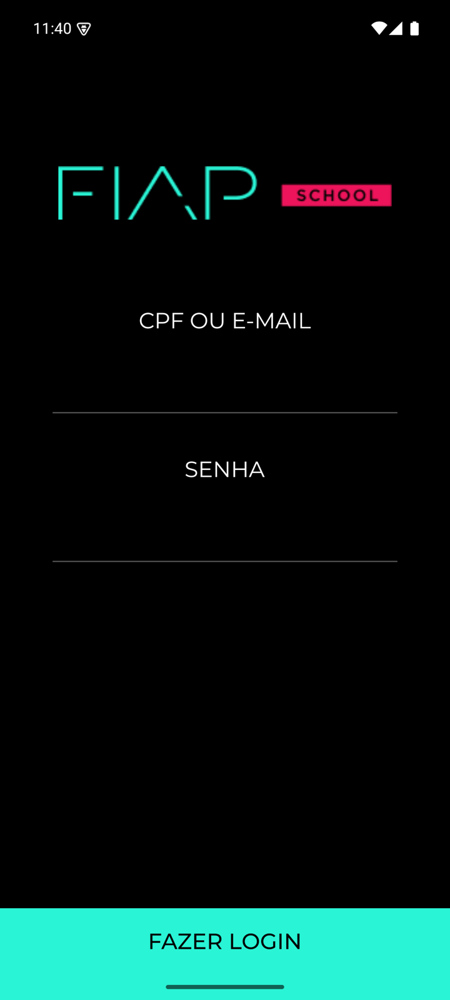
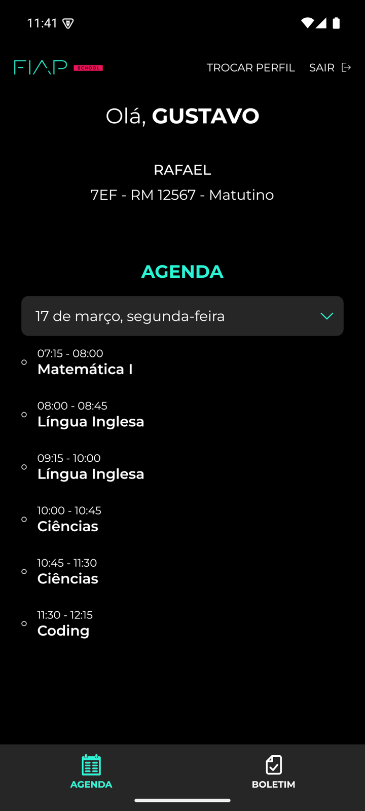
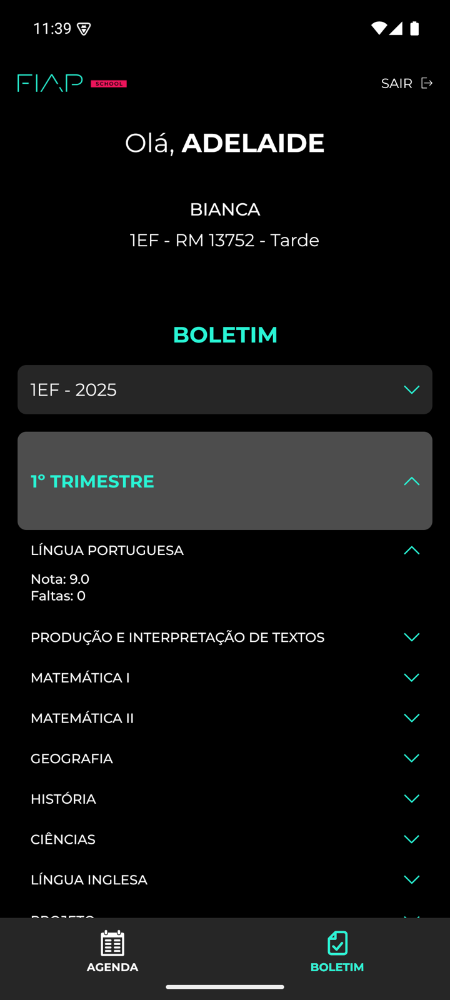
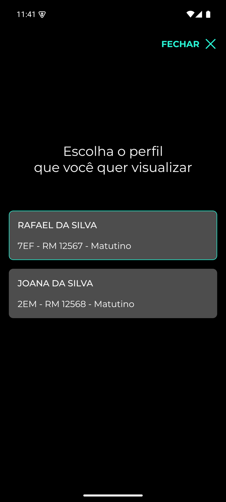
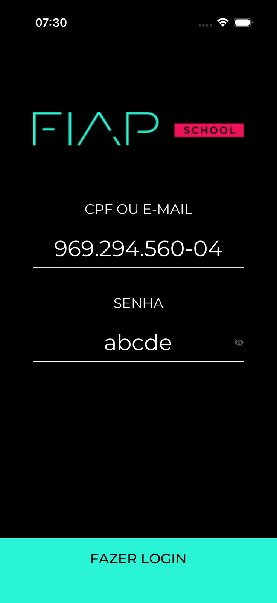
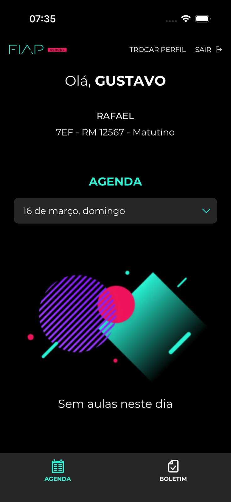
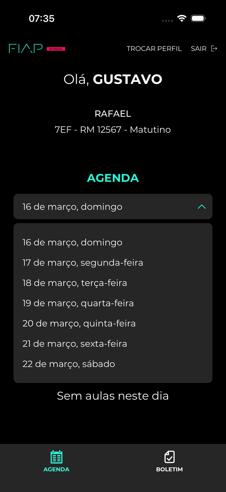
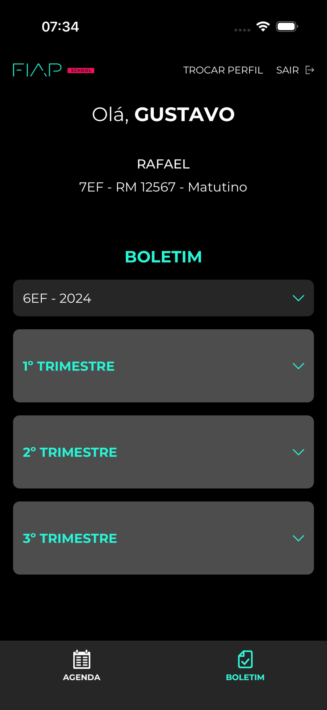
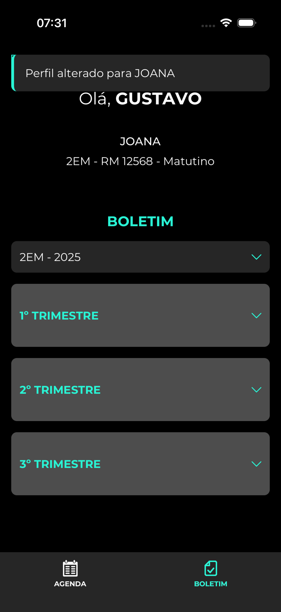
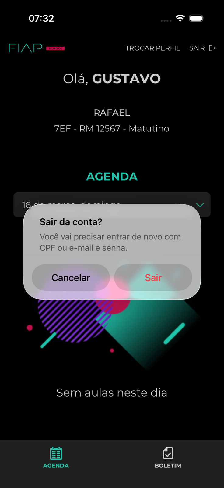

# AppFiap

Aplicativo para responsáveis da FIAP School acompanharem as aulas do dia e o boletim anual do aluno.

Feito em React Native CLI e TypeScript, com o layout do [Figma do desafio](https://www.figma.com/design/lWgkJr0vc9ZiQQylY2J4Zt/Teste-T%C3%A9cnico-Mobile---FIAP?node-id=4001-2), em Restyle. Os dados vêm do Firebase (Authentication + Cloud Firestore), no mesmo contrato do JSON da FIAP. O desenvolvimento seguiu Spec-Driven Development (SDD).

O projeto Firebase `app-fiap-cbb00` já está ligado aos apps Android e iOS. Depois de clonar, basta instalar e rodar.

Foi criado também, uma splashscreen exclusiva, desenvolvida por Ana Carla Paiva para dar mais fluidez e polimento ao app. A arte foi feita baseada na tela inicial do Figma

<p align="center">
  
</p>
<p align="center"><sub>Splash · 6,1 s</sub></p>

<table align="center">
  <tr>
    <td align="center" width="50%">
      <video src="https://github.com/user-attachments/assets/6df41702-a2c7-441f-ad27-f836dcab56fe" width="300" controls muted playsinline></video>
      <br />
      <sub>Fluxo principal</sub>
    </td>
    <td align="center" width="50%">
      <video src="https://github.com/user-attachments/assets/5c2e5f90-7c44-4865-84e9-4445e9df3f26" width="300" controls muted playsinline></video>
      <br />
      <sub>Validações e erros</sub>
    </td>
  </tr>
</table> 

<p align="center">
  
  
  
  
</p>
<p align="center"><sub>Login · Agenda · Boletim · Troca de aluno (emulador Android)</sub></p>

## Destaques

- **Firebase Authentication** com e-mail/senha, Firestore protegido por regra de UID, sessão no Keychain do sistema e a senha nunca gravada em lugar nenhum. Detalhes em [Autenticação](#autenticação).
- **O teclado nunca cobre o campo.** No login, o botão FAZER LOGIN sobe junto com o teclado, e a tela rola sozinha até a senha e a mensagem de erro assim que o teclado termina de abrir, no iOS e no Android.
- **Mostrar senha sem perder o que foi digitado.** O olho no campo SENHA alterna entre `*` e o texto. O campo nativo continua seguro o tempo todo (sem sugestões do teclado, sem copiar), então o iOS não apaga a senha ao ocultar de novo.
- **Testado de ponta a ponta com Maestro.** Sete fluxos em [`.maestro/`](.maestro) cobrem login (todos os erros), olho da senha, agenda, boletim, troca de perfil, saída e sessão persistida, rodando no simulador iOS. Somam-se aos 197 testes unitários do Jest.
- **Animação em todas as telas, respeitando o sistema.** Vídeo na splash, fade entre abas, escolha de aluno subindo de baixo, pulso nos cards, accordion do boletim, dropdown, linha e cursor do campo. Com "Reduzir movimento" ligado no aparelho, as transições são desligadas.
- **Cenários de erro tratados.** Sem internet, dados quebrados, responsável sem alunos, sessão órfã, Keychain falhando e tela que quebra ao renderizar têm mensagem e saída próprias (veja [Offline e rede](#offline-e-rede)).
- **VoiceOver e TalkBack de verdade, não `testID`.** Cada controle anuncia papel, rótulo e estado. Erro de login e tela quebrada entram como alerta. Logo, ícone e ilustração vazia ficam fora da ordem de leitura. Detalhes em [Acessibilidade](#acessibilidade).
- **Engenharia guiada por spec.** Dez specs com critérios de aceite, doze ADRs, camadas impostas por lint e instruções de IA versionadas no repositório.

## Galeria

<p align="center">
  
  
  
  
</p>
<p align="center"><sub>Erro sem o teclado cobrir · Senha visível · Dia sem aulas · Escolha do dia</sub></p>
<p align="center">
  
  
  
</p>
<p align="center"><sub>Boletim de anos anteriores · Aviso de troca de perfil · Confirmação de saída (simulador iOS)</sub></p>

## Telas

| Tela             | O que faz                                                                                               |
| ---------------- | ------------------------------------------------------------------------------------------------------- |
| Splash           | Reproduz o vídeo de abertura uma vez e entrega o restante do app                                        |
| Login            | CPF (máscara `XXX.XXX.XXX-XX`) ou e-mail + senha com olho para mostrar; sessão persiste ao fechar o app |
| Agenda           | Aulas de um dia, com horário e disciplina; troca de dia da semana                                       |
| Boletim          | Ano, turma e trimestres; 2025 no 1º trimestre; anos anteriores quando existem                           |
| Escolha de aluno | Só aparece se o responsável tiver mais de um aluno; volta para a tela de origem                         |
| Sair             | Confirmação nativa antes de encerrar a sessão                                                           |

Nas telas autenticadas: cabeçalho com o responsável, o aluno (nome, RM, turma, período), TROCAR PERFIL quando houver mais de um aluno, SAIR, e abas AGENDA / BOLETIM no rodapé.

## Regras de negócio

### Autenticação

A autenticação foi tratada como em um app de produção:

| Camada      | Como funciona                                                                                                                             |
| ----------- | ----------------------------------------------------------------------------------------------------------------------------------------- |
| Conta       | Firebase Authentication (e-mail/senha). A senha só existe no Firebase                                                                     |
| Dados       | Firestore com regra que deixa cada conta ler só o próprio documento (id = UID) e ninguém escrever pelo app                                |
| Sessão      | Só `{ guardianId, studentRm }`, no Keychain (iOS) / Keystore (Android), nunca em `AsyncStorage`                                           |
| Validação   | CPF (dígitos verificadores) e e-mail conferidos antes de chamar o Firebase; sessão do Keychain e documento do Firestore validados com Zod |
| Privacidade | Mensagem de credencial recusada não diz qual campo errou, para não revelar quem tem conta                                                 |
| Resiliência | Sem internet, Keychain lento ou com falha, sessão órfã e responsável sem alunos têm comportamento definido                                |

Regras:

- O login aceita **CPF ou e-mail**. Digitando letras ou `@`, o campo trata como e-mail; só dígitos viram CPF com máscara `XXX.XXX.XXX-XX`.
- CPF é validado de verdade: 11 dígitos, rejeita sequência repetida (`111.111.111-11`) e confere os dois dígitos verificadores.
- Ordem das frases no CPF: vazio → quantidade → dígitos iguais → verificador → senha vazia → credencial recusada.
- Credencial recusada **não diz** se o erro foi o CPF, o e-mail ou a senha (`CPF ou senha incorretos.` / `E-mail ou senha incorretos.`).
- Não há cadastro nem recuperação de senha (fora do corte).
- A senha nunca é gravada no aparelho nem no Firestore. O Authentication é e-mail/senha; o CPF é traduzido localmente para o e-mail daquele responsável, sem senha.
- O olho do campo SENHA mostra o texto, mas o campo nativo continua no modo seguro: o teclado não aprende a senha, não há copiar/colar e o autopreenchimento fica desligado.
- O teclado nunca fica em cima do campo: o botão sobe com o teclado e a tela rola até a senha e o erro.

### Sessão

- Sessão `{ guardianId, studentRm }` no Keychain. Fecha o app e abre de novo: vai para a agenda, não para o login.
- No primeiro acesso, o aluno da sessão é o **primeiro** da lista.
- TROCAR PERFIL só existe quando há mais de um aluno. Adelaide vê só SAIR; Gustavo vê os dois.
- SAIR pede confirmação nativa. Cancelar (ou toque fora / voltar no Android) mantém a sessão.
- Confirmar o SAIR apaga Keychain, cache do React Query e a conta do Firebase, mesmo se o Keychain falhar.
- Sessão órfã ou inválida (responsável/aluno que não existem mais) é apagada e volta ao login.
- Se o Keychain falhar ao gravar, a sessão vale na memória e a área autenticada abre mesmo assim.
- Se a leitura do Keychain não responder em 3 s, o app trata como sem sessão.

### Offline e rede

O login **precisa de internet**. Sair, restaurar sessão já gravada e trocar de aluno **não**.

| Situação                                           | O que o app faz                                                                                        |
| -------------------------------------------------- | ------------------------------------------------------------------------------------------------------ |
| Sem internet no FAZER LOGIN                        | `"Sem conexão com a internet. Verifique sua rede e tente novamente."` — nem avalia CPF/senha           |
| Firebase recusa a conta                            | Credencial genérica, sem apontar o campo                                                               |
| Conta ok, documento não chega ou quebra o contrato | `"Não foi possível carregar seus dados. Tente novamente."` — sessão **não** é gravada                  |
| Leitura do Firestore falha na área autenticada     | `"Não foi possível carregar seus dados. Tente novamente."` + **TENTAR NOVAMENTE** (até 2 retentativas) |
| Responsável sem alunos                             | `"Não encontramos alunos vinculados à sua conta."` — sessão **não** é gravada                          |
| Tela quebra ao renderizar                          | Fundo preto, `"Algo deu errado."` e **TENTAR NOVAMENTE**                                               |
| App já autenticado, rede cai                       | Agenda, boletim, troca de aluno e SAIR continuam; a sessão no Keychain não depende da nuvem            |

### Agenda

- Mostra só o aluno da sessão, um dia por vez. O dia inicial é o primeiro da lista.
- O dia escolhido vive na tela, não na sessão. Sair volta ao primeiro dia.
- Dia com `aulas: []`: ilustração + `"Sem aulas neste dia"`. Dropdown permanece.
- Aluno sem agenda: `"Nenhuma aula cadastrada."`, sem dropdown.
- Cada objeto de `aulas` vira uma linha, na ordem do documento, mesmo com disciplina repetida.

### Boletim

- Abre no primeiro ano da lista (nos dados da FIAP, 2025). Anos anteriores aparecem no dropdown quando existem — caso do Rafael (`7EF - 2025` e `6EF - 2024`).
- Um trimestre aberto por vez; várias disciplinas podem ficar abertas.
- Nota com uma casa decimal (`9` → `9.0`). Falta inteira. `null` vira `-`. Empty não substitui nota nem falta.
- Aluno sem boletim: `"Nenhum boletim disponível."`, sem dropdown.
- Ano, trimestre e disciplinas abertas vivem na tela. Trocar de aluno zera esse estado.

### Escolha de aluno

- Fora do rodapé. Fecha e devolve a aba de origem (agenda ou boletim).
- Card com nome completo, turma, RM e período. O aluno da sessão vem com borda de destaque.
- Escolher outro aluno regrava a sessão, mostra `Perfil alterado para JOANA` e zera dia/ano das abas.
- Tocar no aluno já selecionado só fecha a tela.

### Acessibilidade

O app fala com o VoiceOver (iOS) e o TalkBack (Android) no próprio componente: papel, rótulo e estado. Não há uma camada extra de acessibilidade.

| Onde                                                         | O que o leitor anuncia                                                                    |
| ------------------------------------------------------------ | ----------------------------------------------------------------------------------------- |
| FAZER LOGIN                                                  | Botão; ocupado enquanto a conta entra                                                     |
| Olho da senha                                                | `Mostrar senha` / `Ocultar senha`; o valor é `*` ou o texto, sem duplicar o rótulo visual |
| Erro de login, dados que não carregam, toast e tela quebrada | Alerta                                                                                    |
| Abas                                                         | Barra de abas; AGENDA / BOLETIM; a ativa vem selecionada                                  |
| Dropdown                                                     | Aberto ou fechado; a opção atual vem selecionada                                          |
| Trimestre e disciplina                                       | Expandido ou recolhido                                                                    |
| Card de aluno                                                | Nome, turma, RM e período numa frase; o da sessão vem selecionado                         |
| Aula                                                         | Horário e disciplina juntos (`07:15 - 08:00, Matemática I`)                               |
| Nota e faltas                                                | Juntas (`Nota: 9.5, Faltas: 0`)                                                           |
| Saudação                                                     | Um cabeçalho (`Olá, GUSTAVO`)                                                             |
| Splash                                                       | Imagem modal `Animação de abertura da FIAP`                                               |
| Logo, ícone e ilustração vazia                               | Decorativos; não entram na ordem de leitura                                               |
| Carregando                                                   | `Carregando`                                                                              |

Com **Reduzir movimento** ligado no aparelho, as transições são desligadas.

## Acesso de teste

| Responsável                | CPF              | E-mail                          | Senha    | Alunos         |
| -------------------------- | ---------------- | ------------------------------- | -------- | -------------- |
| Gustavo da Silva           | `969.294.560-04` | `gustavo-da-silva@example.com`  | `123456` | Rafael e Joana |
| Adelaide Silveira da Costa | `508.795.670-07` | `adelaide-silveira@example.com` | `987654` | Bianca         |

O Gustavo tem dois alunos (mostra TROCAR PERFIL) e boletim de 2024 e 2025 no Rafael.

## Stack

| Item      | Escolha                                                          |
| --------- | ---------------------------------------------------------------- |
| App       | React Native 0.88 (CLI, sem Expo), React 19, TypeScript `strict` |
| UI        | `@shopify/restyle`, Reanimated, SVG, `react-native-video`        |
| Navegação | React Navigation 7 (native-stack + bottom-tabs)                  |
| Dados     | Firebase Auth + Firestore, React Query, Zod                      |
| Sessão    | `react-native-keychain`                                          |
| Rede      | `@react-native-community/netinfo`                                |
| Qualidade | Jest, ESLint, Prettier, Husky                                    |

Gerenciador de pacotes: Yarn 3.6.4. Node.js >= 22.11.0.

## Pré-requisitos

- Node.js >= 22.11.0
- Yarn (versão fixada no repositório; `corepack enable`)
- Ambiente React Native: [Set Up Your Environment](https://reactnative.dev/docs/set-up-your-environment)
- iOS: Ruby, Bundler e CocoaPods

## Como rodar

```sh
yarn install
yarn start

# em outro terminal
yarn android
# ou, no iOS (primeira vez e após mudar dependências nativas):
bundle install
cd ios && bundle exec pod install && cd ..
yarn ios
```

`yarn install` também registra o hook de pre-commit.

As fontes (Montserrat) já estão no iOS e no Android. O player de vídeo, o SVG e o Reanimated são nativos: depois de instalar dependências, rode `bundle exec pod install` em `ios/` e recompile. Recarregar o Metro não basta. Depois de instalar ou atualizar o Reanimated, inicie o Metro com `yarn start --reset-cache`.

## Firebase

Já configurado neste repositório (`android/app/google-services.json` e `ios/AppFiap/GoogleService-Info.plist`). Com internet, o app fala com o projeto `app-fiap-cbb00`.

- **Authentication:** e-mail/senha, com os dois usuários da tabela.
- **Cloud Firestore:** coleção `responsaveis`, um documento por conta (id = UID do Authentication), no formato do JSON da FIAP, **sem** o campo `senha`. O campo `id` do JSON (`1` ou `2`) continua dentro do documento.
- **Regras** ([firestore.rules](firestore.rules)): o usuário autenticado lê só o documento cujo id é o UID da conta; ninguém escreve pelo app.
- **Login por CPF:** o Authentication só conhece e-mail. O app traduz o CPF pelo diretório local `src/features/auth/data/loginDirectory.ts` (sem senha).
- O JSON original fica em `src/shared/mocks/responsaveis.json` só como fixture dos testes.

Para usar um projeto Firebase próprio:

1. Crie o projeto e registre os apps Android (`com.appfiap`) e iOS (`org.reactjs.native.example.AppFiap`). Substitua `google-services.json` e `GoogleService-Info.plist`.
2. Em Authentication, ative E-mail/senha e crie os usuários da tabela.
3. Em Firestore, crie a coleção `responsaveis` com um documento por responsável (id do documento = UID da conta no Authentication), copiando `src/shared/mocks/responsaveis.json` sem o campo `senha`.
4. Publique as regras: `firebase deploy --only firestore:rules` (Firebase CLI, com `firebase use <projeto>`).

## Arquitetura e SDD

O código em `src/` tem quatro camadas: `app`, `features` (`splash`, `auth`, `schedule`, `report-card`), `shared` e `assets`. Cada feature só exporta pelo `index.ts`. As regras de dependência são impostas pelo ESLint.

Cada fatia de produto nasceu de uma spec em `docs/specs/`, com ADRs para as escolhas de biblioteca. O mapa está em [docs/README.md](docs/README.md). As instruções usadas pelos agentes de IA estão em [AGENTS.md](AGENTS.md).

## Qualidade

```sh
yarn typecheck
yarn lint
yarn test
yarn validate          # typecheck + lint + formatação + testes
```

O pre-commit (Husky + lint-staged) verifica formatação, lint e tipos em cada commit.

### Testes de ponta a ponta (Maestro)

Todo o fluxo do app foi testado com [Maestro](https://maestro.mobile.dev) no simulador iOS. Os fluxos ficam em [`.maestro/`](.maestro):

| Fluxo                | O que confere                                                                       |
| -------------------- | ----------------------------------------------------------------------------------- |
| `01-login-erros`     | Cada frase de erro do login, na ordem, até a credencial recusada                    |
| `02-olho-da-senha`   | Mostrar, digitar, ocultar e digitar de novo sem perder nenhum caractere             |
| `03-agenda`          | Primeiro dia sem aulas, troca de dia pelo dropdown e aulas do novo dia              |
| `04-boletim`         | Boletim de 2025 e navegação para 2024                                               |
| `05-trocar-perfil`   | Escolha de aluno, aviso "Perfil alterado para JOANA" e volta para a aba             |
| `06-sair`            | Confirmação de saída: cancelar mantém a sessão, sair volta ao login                 |
| `07-sessao-persiste` | Fechar e abrir o app mantém a sessão; responsável com um aluno não vê TROCAR PERFIL |

Com o app instalado e o Metro rodando:

```sh
maestro test .maestro
```

O fluxo de saída toca no botão "Sair" do alerta nativo por posição na tela, calibrada para o iPhone 17 Pro.

## Solução de problemas

- **iOS:** o Firebase iOS 13 só vem por SPM e exige frameworks dinâmicos (já configurado no `Podfile`). Não exporte `USE_FRAMEWORKS=static`.
- **Android:** o Firebase exige Kotlin 2.4 (`kotlinVersion` em `android/build.gradle`). Se um build antigo falhar, rode `cd android && ./gradlew clean`.
- **Metro:** depois de trocar de branch ou instalar dependências, `yarn start --reset-cache`.
