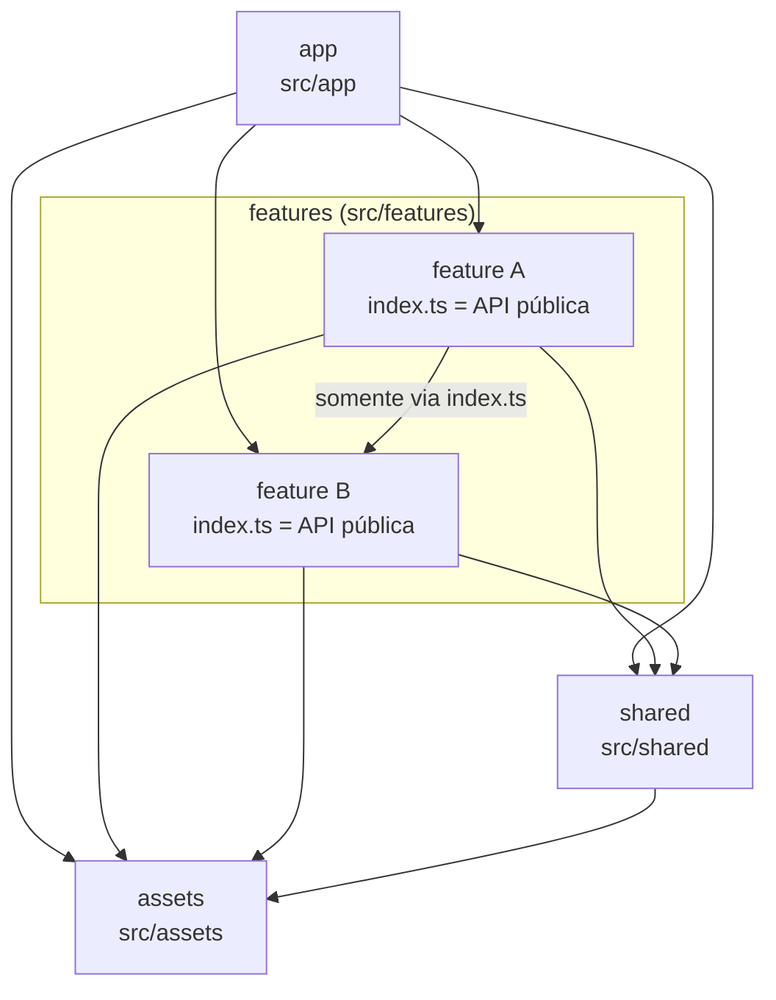

# Arquitetura

O AppFiap é um app React Native (CLI) em TypeScript, organizado por **features** (domínios de negócio). A decisão está registrada no [ADR 0001](adr/0001-arquitetura-feature-based.md).

## Camadas

| Camada    | Pasta                  | Responsabilidade                                                                                                                                       |
| --------- | ---------------------- | ------------------------------------------------------------------------------------------------------------------------------------------------------ |
| `app`     | `src/app/`             | Bootstrap: `App.tsx`, composição de providers globais e navegação raiz                                                                                 |
| `feature` | `src/features/<nome>/` | Um domínio de negócio completo: telas, componentes, hooks, acesso a API, estado e tipos                                                                |
| `shared`  | `src/shared/`          | Código reutilizável e sem regra de negócio: design system, hooks genéricos, utilitários, tema, configuração, DTO e validação do contrato compartilhado |
| `assets`  | `src/assets/`          | Arquivos estáticos (fontes, imagens, ícones)                                                                                                           |

Todo arquivo `.js/.jsx/.ts/.tsx` dentro de `src/` precisa pertencer a uma dessas camadas. Arquivo fora delas é erro de lint (`boundaries/no-unknown-files`).

## Regras de dependência

| De ↓ / Para → | `app` | `feature` (index.ts) | `feature` (arquivo interno) | `shared` | `assets` |
| ------------- | ----- | -------------------- | --------------------------- | -------- | -------- |
| `app`         | ✅    | ✅                   | ❌                          | ✅       | ✅       |
| `feature`     | ❌    | ✅                   | ✅ só a própria feature     | ✅       | ✅       |
| `shared`      | ❌    | ❌                   | ❌                          | ✅       | ✅       |
| `assets`      | ❌    | ❌                   | ❌                          | ❌       | ✅       |

Em palavras:

1. `app` pode importar de `features` (somente pelo `index.ts`), `shared` e `assets`.
2. Uma feature pode importar de `shared`, `assets`, dos próprios arquivos e do `index.ts` de outras features. Ela nunca importa arquivos internos de outra feature nem de `app`.
3. `shared` não pode importar de `features` nem de `app`.
4. `assets` não importa código de nenhuma camada.
5. Bibliotecas externas (`node_modules`) não são restringidas pelas regras de camada. A inclusão de uma nova biblioteca segue [AGENTS.md](../AGENTS.md#proibições).

## Como as regras são impostas

As regras valem para qualquer pessoa ou agente de IA, porque são verificadas por ferramentas e não só descritas:

| Garantia                                                 | Ferramenta                                                                               | Arquivo                                      |
| -------------------------------------------------------- | ---------------------------------------------------------------------------------------- | -------------------------------------------- |
| Dependência entre camadas e API pública das features     | `eslint-plugin-boundaries` (`boundaries/dependencies`, `boundaries/no-unknown-files`)    | `.eslintrc.js`                               |
| Resolução dos aliases `@/` no lint                       | `eslint-import-resolver-typescript`                                                      | `.eslintrc.js`                               |
| Aliases no TypeScript                                    | `paths`                                                                                  | `tsconfig.json`                              |
| Aliases no Metro (bundle)                                | `babel-plugin-module-resolver`                                                           | `babel.config.js`                            |
| Aliases nos testes                                       | `moduleNameMapper`                                                                       | `jest.config.js`                             |
| Tipagem estrita                                          | `strict`, `noUncheckedIndexedAccess`, `noImplicitOverride`, `noFallthroughCasesInSwitch` | `tsconfig.json`                              |
| Imports sempre com alias `@/` (proibido `../` em `src/`) | `no-restricted-imports`                                                                  | `.eslintrc.js`                               |
| Proibição de `any`                                       | `@typescript-eslint/no-explicit-any`                                                     | `.eslintrc.js`                               |
| Desabilitar regra de lint exige justificativa            | `eslint-comments/require-description`                                                    | `.eslintrc.js`                               |
| Formatação, lint e typecheck antes de cada commit        | Husky + lint-staged                                                                      | `.husky/pre-commit`, `lint-staged.config.js` |

O hook de pre-commit roda o Prettier (`--check`) e o ESLint nos arquivos staged. Se houver arquivos `.ts`/`.tsx` staged, roda também `tsc --noEmit` no **projeto inteiro**, porque o `tsc` ignora o `tsconfig.json` quando recebe arquivos individuais.

`yarn validate` roda typecheck, lint, verificação de formatação (Prettier) e testes. É a verificação usada na [definição de pronto](../AGENTS.md#definição-de-pronto).

## Alterando a arquitetura

Qualquer mudança de camada, regra de dependência ou alias exige:

1. um ADR novo em [adr/](adr/) (veja [record-adr](ai/skills/record-adr/SKILL.md));
2. a alteração nos arquivos de configuração listados acima;
3. a atualização deste documento e de [estrutura-de-pastas.md](estrutura-de-pastas.md) no mesmo commit.
