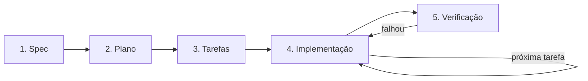

# Fluxo de Spec-Driven Development (SDD)

Toda fatia de produto nova nasce de uma spec aprovada. O código é consequência da spec. Spec não descreve instalação de lib (isso é ADR) nem inventário de componente (isso é teste).

| Etapa            | Artefato                       | Quem aprova              | Guia                                               |
| ---------------- | ------------------------------ | ------------------------ | -------------------------------------------------- |
| 1. Spec          | `docs/specs/NNN-nome/spec.md`  | Responsável pelo produto | [ai/flows/spec.md](ai/flows/spec.md)               |
| 2. Plano         | `docs/specs/NNN-nome/plan.md`  | Responsável técnico      | [ai/flows/plano.md](ai/flows/plano.md)             |
| 3. Tarefas       | `docs/specs/NNN-nome/tasks.md` | Responsável técnico      | [ai/flows/tarefas.md](ai/flows/tarefas.md)         |
| 4. Implementação | código + testes                | Revisão de PR            | [ai/flows/implementar.md](ai/flows/implementar.md) |
| 5. Verificação   | `yarn validate` passando       | Automático               | [ai/flows/implementar.md](ai/flows/implementar.md) |

## Etapas

1. **Spec**: o quê, critérios de aceite e fora do escopo. Curta. Sem narrativa.
2. **Plano**: como. Arquivos, CAs, dependências novas, ADRs.
3. **Tarefas**: checklist pequena e verificável.
4. **Implementação**: uma tarefa por vez. Teste só o arquivo que decide o CA, um caso por critério, sem repetir em quem só consome.
5. **Verificação**: `yarn validate` precisa passar.

`plan.md` e `tasks.md` são o mapa da construção. Quando a spec fica `Concluída`, os dois arquivos saem. O contrato que permanece é `spec.md`.

`docs/arquitetura.md`, `docs/convencoes.md` e os ADRs só mudam se a tarefa alterar camada, convenção, dependência estrutural ou decisão arquitetural. Não se reescreve documentação porque um arquivo de código nasceu ou mudou de nome.

## Status de uma spec

O cabeçalho de `spec.md` tem o campo `Status`:

- `Rascunho`: em elaboração.
- `Aprovada`: liberada para a próxima etapa. Só quem aprova altera para este valor.
- `Em implementação`: existe pelo menos uma tarefa concluída.
- `Concluída`: todas as tarefas concluídas; `plan.md` e `tasks.md` foram apagados.

O cabeçalho de `plan.md` usa `Rascunho` ou `Aprovado`, com a mesma regra de aprovação.

Nenhum plano começa sem spec `Aprovada`, e nenhuma implementação começa sem plano `Aprovado`.

## Mudança de requisito durante a implementação

Pare, atualize a `spec.md`, obtenha nova aprovação e só então ajuste `plan.md` e `tasks.md`. Código nunca diverge da spec aprovada.
