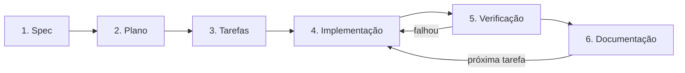

# Fluxo de Spec-Driven Development (SDD)

Toda feature nasce de uma especificação aprovada. O código é consequência da spec, e a documentação acompanha o código.

| Etapa            | Artefato                       | Quem aprova                       | Guia de execução                                         |
| ---------------- | ------------------------------ | --------------------------------- | -------------------------------------------------------- |
| 1. Spec          | `docs/specs/NNN-nome/spec.md`  | Responsável pelo produto          | [ai/flows/spec.md](ai/flows/spec.md)                     |
| 2. Plano         | `docs/specs/NNN-nome/plan.md`  | Responsável técnico               | [ai/flows/plano.md](ai/flows/plano.md)                   |
| 3. Tarefas       | `docs/specs/NNN-nome/tasks.md` | Responsável técnico               | [ai/flows/tarefas.md](ai/flows/tarefas.md)               |
| 4. Implementação | código + testes                | Revisão de PR                     | [ai/flows/implementar.md](ai/flows/implementar.md)       |
| 5. Verificação   | `yarn validate` passando       | Automático (pre-commit e revisão) | [ai/flows/implementar.md](ai/flows/implementar.md)       |
| 6. Documentação  | `docs/` atualizado             | Revisão de PR                     | [ai/flows/atualizar-docs.md](ai/flows/atualizar-docs.md) |

## Etapas

1. **Spec**: descreve _o quê_ e _por quê_: problema, usuários, fluxos, critérios de aceite em Dado/Quando/Então, estados de erro, vazio e carregamento, e o que fica fora do escopo. Não fala de implementação. Template: [specs/\_templates/spec.md](specs/_templates/spec.md).
2. **Plano**: descreve _como_: telas, componentes, dados, APIs, estado, impacto em outras features, riscos e dependências novas, com justificativa. Respeita [arquitetura.md](arquitetura.md). Template: [specs/\_templates/plan.md](specs/_templates/plan.md).
3. **Tarefas**: quebra o plano em uma checklist de tarefas pequenas, independentes e verificáveis. Template: [specs/\_templates/tasks.md](specs/_templates/tasks.md).
4. **Implementação**: uma tarefa por vez. Os testes são derivados dos critérios de aceite.
5. **Verificação**: `yarn validate` precisa passar.
6. **Documentação**: os documentos afetados em `docs/` são atualizados na mesma tarefa e no mesmo commit, e a tarefa é marcada como concluída em `tasks.md`.

## Status de uma spec

O cabeçalho de `spec.md` tem o campo `Status`:

- `Rascunho`: em elaboração.
- `Aprovada`: liberada para a próxima etapa. Só quem aprova altera para este valor.
- `Em implementação`: existe pelo menos uma tarefa concluída.
- `Concluída`: todas as tarefas concluídas.

O cabeçalho de `plan.md` usa `Rascunho` ou `Aprovado`, com a mesma regra de aprovação.

Nenhum plano começa sem spec `Aprovada`, e nenhuma implementação começa sem plano `Aprovado`.

## Mudança de requisito durante a implementação

Pare a implementação, atualize a `spec.md`, obtenha nova aprovação e só então ajuste `plan.md` e `tasks.md`. Código nunca diverge da spec aprovada.
